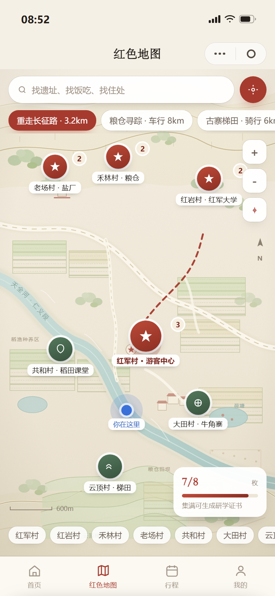

# 薪火仁义 · 天全县仁义镇红色研学与在地体验小程序

> 数字乡村服务设计参赛作品。一个把「红色研学 + 在地吃住 + 非遗体验」做成一条可下单、可排程、可履约、可分账链路的服务原型。

**在线体验**：部署后由 Render 提供地址（见仓库右侧 Environments / 本文末尾）。
**单机版**：直接双击 `薪火仁义-交互原型.html`，不联网也能完整演示。



## 这是什么

- **21 个高保真界面**，全部可点，不是静态图：预约 → 排程 → 支付 → 凭证 → 行程 → 打卡 → 证书；村民工作台 → 核销 → 运营看板。
- **手绘红色地图**：山梁、林地、梯田、田块、天全河与荷塘；7 个村庄点位、三条线路可切、缩放平移、导航态。
- **真实数据口径**：村子数与遗址数、红军村 1935 年驻军 118 天、筹集军粮约 10 万公斤、稻渔亩产值等均取自公开资料；设计推演的数字（画像、访谈、运营指标）在说明书里单独标注。
- **状态栏是真的**：时间与电量读设备真实状态，电量低于 20% 转红、充电显示绿色。
- **语音讲解是真的**：红军井详情页内置一段 1′25″ 的中文讲解音频，可播放、可拖进度。

## 多设备联机

`tools/server.py` 起一个零依赖的本地服务，多台设备打开同一地址就共享同一份余位：

```bash
python tools/server.py 8787
# 手机连同一 Wi-Fi，打开 http://<本机IP>:8787/join 扫码
```

跨网络演示：`启动公网演示.cmd` 会再开一条 ssh 反向隧道，打印公网地址与二维码。

同步机制：客户端每 1.5 秒拉一次 `/api/state`；下单走 `POST /api/order`，服务端按天扣减餐位，排不下直接驳回并提示还剩几位。

| 接口 | 说明 |
|---|---|
| `GET /api/state?c=<clientId>` | 各日期剩余餐位、最近订单、在线人数 |
| `POST /api/order` | `{date, people, name}` → 成功返回订单号与剩余餐位 |
| `POST /api/cancel` | `{id}` 取消订单 |
| `POST /api/reset` | 清空所有订单（演示用） |
| `GET /join` | 扫码页（`?u=<公网地址>` 可指定展示地址） |
| `GET /qr.svg` | 当前地址的二维码 |
| `GET /healthz` | 健康检查 |

> 这是演示级后端：数据在内存、重启即清零、轮询而非推送。生产版应换成 WebSocket/云函数 + 数据库事务（行级锁防超卖）。

## 部署到 Render

仓库里带了 `render.yaml`（Blueprint）。两种方式：

1. **一键 Blueprint**：Render 控制台 → New + → Blueprint → 选本仓库 → Apply。
2. **手动建 Web Service**：Runtime 选 Python，Build `pip install -r requirements.txt`，Start `python tools/server.py`。

免费实例 15 分钟无访问会休眠，冷启动约 30–50 秒，答辩前先打开一次预热。

## 目录

```
薪火仁义-交互原型.html   主交付物：单文件可点击原型（4.8MB，含图片与音频）
薪火仁义-设计说明书.docx  30 页设计说明：过程、界面、后台逻辑、验证、落地
设计图版.html            旅程图 / 服务蓝图 / 信息架构 / 流程图 / 设计过程
assets/img/              原型内嵌的 19 张照片（同名 JPEG，可替换）
shots/                   全部界面与图版截图（2 倍图）
tools/server.py          联机演示服务（Python 标准库）
tools/cap.py             批量截图脚本（Headless Edge）
tools/build_doc.py       说明书生成脚本（python-docx）
render.yaml              Render Blueprint
```

## 素材说明

界面照片为公开渠道实拍素材，用于版式与氛围示意；建议替换为红军村实拍（`assets/img/` 同名覆盖即可）。语音讲解为系统 TTS 合成示例，正式版应替换为讲解员录音。
